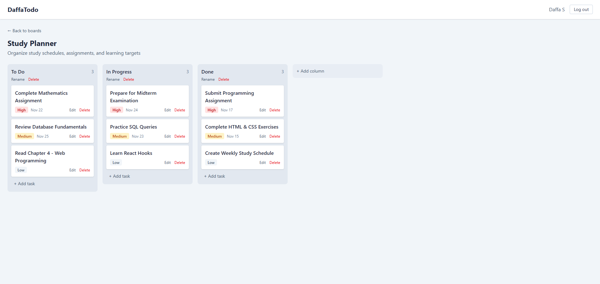
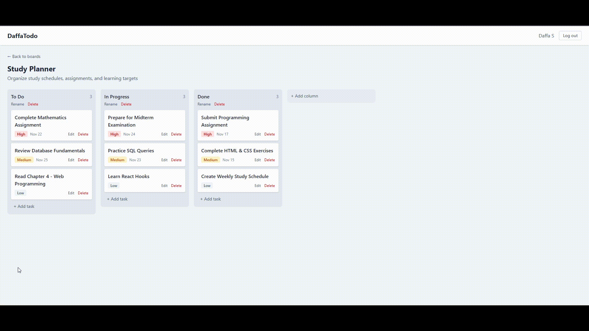
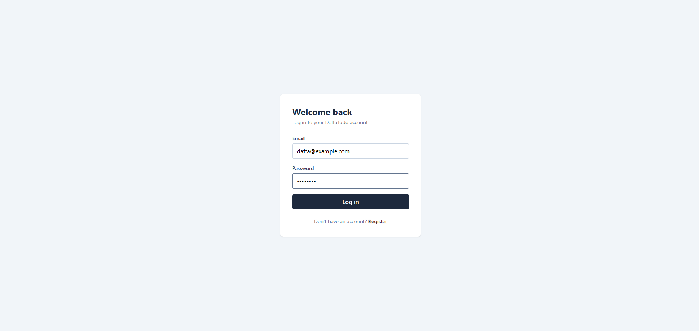
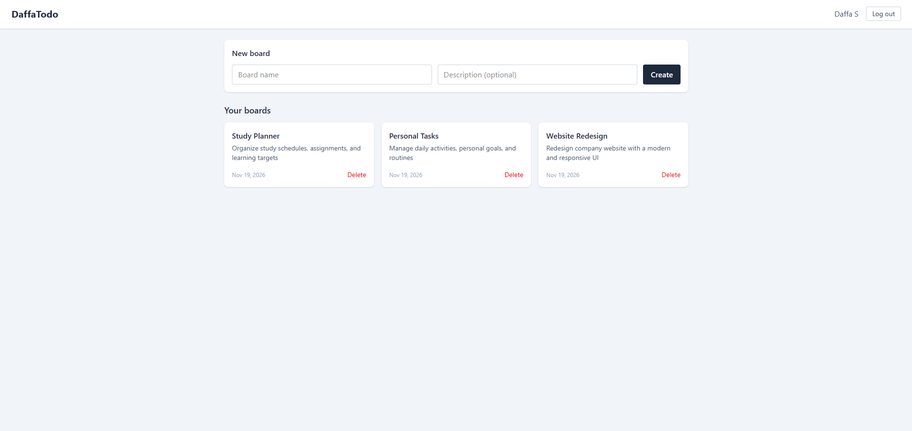
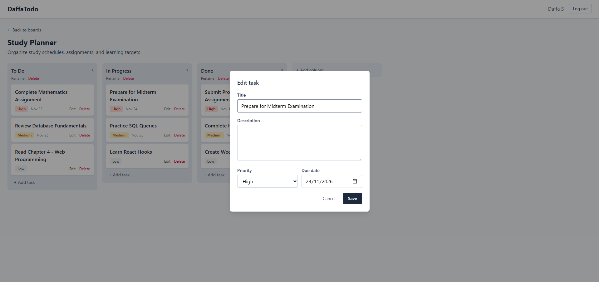

# DaffaTodo

[](https://github.com/daffahi/DaffaTodo/actions/workflows/ci.yml)

A simple Kanban-style task management app. Users organize work on boards made of columns and tasks, and move tasks around with drag and drop.



## Features

- Registration and login with JWT authentication
- Multiple boards per user, with each user's data isolated from everyone else's
- Columns: add, rename, and delete
- Tasks: create, edit (title, description, priority, due date), and delete
- Drag and drop tasks within and between columns, with the order saved to the database
- Keyboard-accessible drag and drop



## Tech Stack

| Layer | Technologies |
|---|---|
| Frontend | React, TypeScript, Vite, Tailwind CSS, React Router, TanStack Query, dnd-kit, Axios |
| Backend | C#, .NET 10, ASP.NET Core Web API, Entity Framework Core (Code First), ASP.NET Core Identity |
| Database | SQL Server |
| Testing and CI | xUnit integration tests, GitHub Actions |

## Screenshots

| Login | Boards |
|---|---|
|  |  |



## Getting Started

### Prerequisites

- [.NET 10 SDK](https://dotnet.microsoft.com/download)
- [Node.js](https://nodejs.org/) 20.19+ or 22.12+
- SQL Server (LocalDB, Express, or Developer edition)

The default connection string in `src/DaffaTodo.Api/appsettings.json` uses `localhost` with Windows authentication. Change it if your SQL Server setup is different.

### 1. Clone the repository

```bash
git clone https://github.com/daffahi/DaffaTodo.git
cd DaffaTodo
```

### 2. Create the database

```bash
dotnet tool install --global dotnet-ef
dotnet ef database update --project src/DaffaTodo.Api
```

### 3. Set the JWT signing key

The key is kept in [user secrets](https://learn.microsoft.com/aspnet/core/security/app-secrets), not in the repository. Use any random string of at least 32 characters.

```bash
dotnet user-secrets set "Jwt:Key" "<a random string of at least 32 characters>" --project src/DaffaTodo.Api
```

### 4. Run the API

```bash
dotnet dev-certs https --trust
dotnet run --project src/DaffaTodo.Api --launch-profile https
```

The API runs on `https://localhost:7043`. In development, interactive API docs are available at `https://localhost:7043/scalar/v1`.

### 5. Run the client

In a second terminal:

```bash
cd client
npm install
npm run dev
```

Open `http://localhost:5173`.

### Run the tests

```bash
dotnet test
```

The tests do not need SQL Server (see Design Notes).

## Project Structure

```
DaffaTodo/
├── .github/workflows/ci.yml        CI: backend build and tests, frontend lint and build
├── client/                         React app (Vite, TypeScript, Tailwind)
│   └── src/                        api, components, context, hooks, pages, types, utils
├── src/DaffaTodo.Api/              ASP.NET Core Web API
│   └── ...                         Controllers, Data, Dtos, Entities, Extensions, Migrations, Services
├── tests/DaffaTodo.Api.Tests/      Integration tests
└── DaffaTodo.slnx
```

## API Overview

All endpoints except `auth` require a `Bearer` token.

| Method | Route | Description |
|---|---|---|
| POST | `/api/auth/register` | Create an account |
| POST | `/api/auth/login` | Log in and receive a JWT |
| GET | `/api/boards` | List the current user's boards |
| POST | `/api/boards` | Create a board (with default columns) |
| GET | `/api/boards/{id}` | Get a board with its columns and tasks |
| PUT | `/api/boards/{id}` | Update a board |
| DELETE | `/api/boards/{id}` | Delete a board |
| POST | `/api/boards/{boardId}/columns` | Add a column |
| PUT | `/api/columns/{id}` | Rename a column |
| DELETE | `/api/columns/{id}` | Delete a column and its tasks |
| POST | `/api/columns/{columnId}/tasks` | Add a task |
| PUT | `/api/tasks/{id}` | Update a task |
| PATCH | `/api/tasks/{id}/move` | Move a task to a column and position |
| DELETE | `/api/tasks/{id}` | Delete a task |

## Design Notes

- **Ownership is enforced on the server.** Every query is filtered by the authenticated user, and a resource that belongs to someone else returns `404` instead of `403`, so ids cannot be probed.
- **Order is stored explicitly.** Columns and tasks have a `Position` that is renumbered after a move or delete, so it stays contiguous (0, 1, 2, ...).
- **DTOs separate the API from the database model.** Entities are never returned directly.
- **Responsive drag and drop.** The board updates locally while a card is dragged and is saved when it is dropped. If saving fails, the board reverts to the server state.
- **Integration tests run the real API in memory** against SQLite, which enforces foreign keys and cascade deletes unlike EF Core's in-memory provider. This lets CI run them without a SQL Server instance.

## License

Released under the [MIT License](LICENSE).
